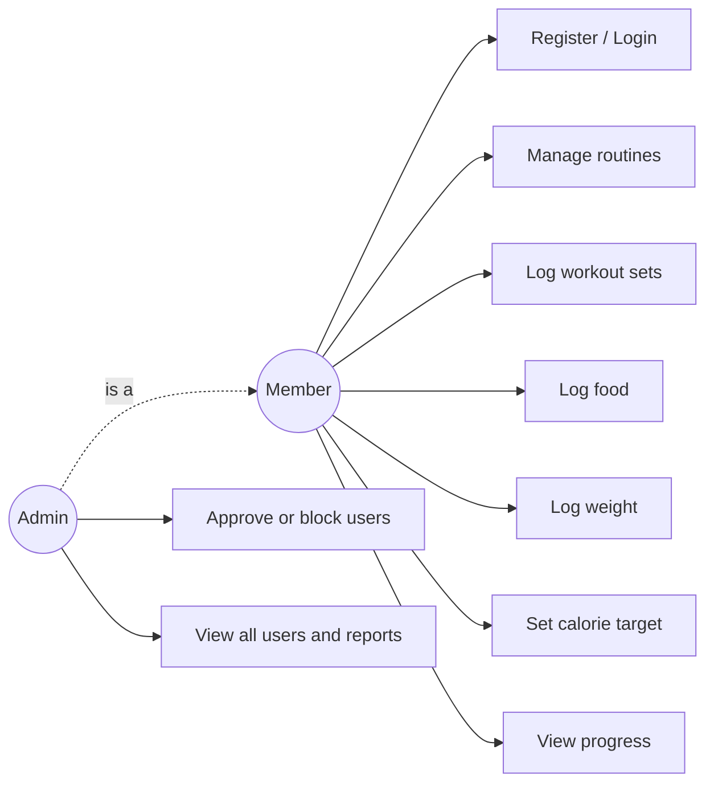
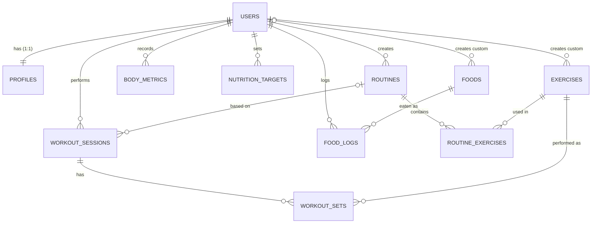

# PPT_FINAL_REVIEW.md: FitStack (23AIE303 DBMS), master source for the final review

**Sources cross-checked:** `final project-GUIDELINE 23AIE303 DBMS.docx` (rules, marks, report + GitHub structure), `final review ppt -22AIE303-DBMS.pptx` (7-slide template) and `Final_review_friend_pratheep.pptx` (another team's finished deck, used to find what examiners are used to seeing; see "Final slide order" and "Added slides").
Note: the guideline says **23AIE303**, the sample PPT file name says 22AIE303. Use **23AIE303** on the title slide.

**Fill before presenting:** `[TEAM NO]`, `[NAME – ROLL NO]` for every member, `[BATCHNO_GROUPNO]`, GitHub URL.

---

## 0. What the faculty evaluates (from the guideline)

| Item | Marks | What wins it |
|---|---|---|
| Presentation + Report | 9 | All template sections present, clean diagrams, real SQL, report follows the given order |
| Project update | 1 | Say clearly what is done today vs the last review |
| Viva (combined with lab marks) | 10 | You can explain *your* schema, keys, normalization, queries, and demo live |

**Submit:** PPT + Report (PDF) + ZIP (code + SQL + docs), one member only, before the review. Folder name `BATCHNO_GROUPNO_PROJECTNAME` (e.g. `B12_G03_FITSTACK`).

**Project must visibly show:** database design **and** SQL implementation (DDL with PK / FK / CHECK / UNIQUE / ON DELETE CASCADE; multi-table joins, subqueries, GROUP BY, aggregates; secure DB access: pooling + parameterized queries).

### Requirement → slide map (nothing missed)

| Required (guideline / template) | Slide |
|---|---|
| Title, team number, members + roll nos | 1 |
| Problem statement and objectives | 2 |
| UML (Use Case **or** Class) | 3 |
| ER diagram (entities, attributes, relationships) | 4 |
| Relational schema (PK, FK, constraints) | 5 |
| Normalization proof to 3NF / BCNF, functional dependencies | 6 |
| Work completed (implementation, DDL, secure access) | 7 |
| Advanced SQL: joins, subqueries, GROUP BY, aggregates | 8–9 |
| Output / demo evidence, screenshots | 10 |
| Conclusion and future scope | 11 |
| Thank you / Q&A | 12 |

The 7 template headings are all kept. Slides 4–6 split the template's single "Database Design & Normalization" slide, and 7–10 split "Work Completed & Output". If you must stay at 7 slides, merge 4+5+6 and 7+8+9+10.

### Final slide order (after comparing with the friend's deck, `Final_review_friend_pratheep.pptx`)

Another team's deck adds five things the template doesn't spell out: a separate **Objectives** slide, an **Actors/users** slide, a **Functional Blocks / Modules** slide, a signature **analysis slide** (their purchase funnel with stage-by-stage SQL and conversion formulas) and a **CRUD operations table**. Examiners have seen this style, so add the same five (content in "Added slides" below). Their handwritten ER/schema diagrams were ignored on purpose; ours are exported from Workbench.

| Final # | Slide | Where the content is |
|---|---|---|
| 1 | Title (team no, names + roll nos in the college format, e.g. `CB.SC.U4AIE24xxx`) | Slide 1 |
| 2 | Problem Statement (+ existing difficulties, why needed) | Slide 2 + "Slide 2 extras" |
| 3 | **Objectives** (new) | Added slide A |
| 4 | **Users / Actors** (new) | Added slide B |
| 5 | UML Use Case diagram | Slide 3 |
| 6 | ER Diagram | Slide 4 |
| 7 | Relational Schema | Slide 5 |
| 8 | Normalization | Slide 6 |
| 9 | **Functional Blocks / Modules** (new) | Added slide C |
| 10 | Work Completed: Implementation | Slide 7 |
| 11 | **Engagement Funnel Analysis** (new, our version of their funnel slide) | Added slide D |
| 12 | Advanced SQL 1/2 | Slide 8 |
| 13 | Advanced SQL 2/2 | Slide 9 |
| 14 | **CRUD operations table** (new) | Added slide E |
| 15 | Output / Demo | Slide 10 |
| 16 | Conclusion and Future Scope | Slide 11 |
| 17 | Thank You | Slide 12 |

17 slides is normal (the friend's deck has 18). Section numbers elsewhere in this file ("Slide 8", etc.) refer to the original numbering above, not the final order.

---

## 1. Flow (storytelling)

**Problem → Design → Proof it is correct → Implementation → Queries → Live output → Close.**
One-line thread to repeat: *"Every table exists to remove a specific redundancy, and every constraint exists to stop a specific bad row."*

---

## 2. Slide-by-slide

### Slide 1: Title
**On slide:** FitStack: Fitness Training & Nutrition Tracking Database System · 23AIE303 DBMS · Team `[TEAM NO]` · `[NAME – ROLL NO]` ×N.
**Say (10 s):** "We built FitStack, a database system for tracking workouts, food and body weight. This review covers design, normalization, SQL and a live demo."

### Slide 2: Problem Statement & Objectives
**On slide:**
- **Problem:** people log gym sessions, meals and weight in separate apps/spreadsheets, with duplicated data (same food typed again and again), no links between them, and no way to ask questions like "how did my intake compare with my target on training days?"
- **Gap:** spreadsheets have no integrity (typos, orphan entries, deleted users leaving data behind).
- **Objectives:** (1) one relational schema linking users, training, nutrition, body metrics; (2) enforce integrity with keys and constraints; (3) normalized to 3NF/BCNF; (4) answer real questions with advanced SQL; (5) working app on MySQL.
**Say:** emphasise *integrity + linked data*, not fitness. "The domain is fitness; the project is the database."
**Evidence:** none needed (text slide).

### Slide 3: UML: Use Case Diagram
**Draw (diagram on slide):** actors **Member**, **Admin**; system boundary "FitStack".
- Member: Register / Login (password + code) · Manage routines · Log workout (sessions, sets) · Log food · Log weight · Set daily calorie target · View progress & history.
- Admin (extends Member): Approve / block users · View all users · Run reports.
- `<<include>>` Login in every use case; `<<extend>>` "Mark personal record" on Log workout.

(Redraw in draw.io / PowerPoint with the UML oval notation for the final slide.)
**Say:** "Two actors. Members own their own data; admin controls access. These use cases map one-to-one to the tables you'll see next."
**Evidence:** exported diagram image.

### Slide 4: ER Diagram
**On slide:** the Workbench **EER diagram** of `fitstack` (Database → Reverse Engineer). Highlight with colours: **users** (hub), **junction tables** (`routine_exercises`, `workout_sets`, `food_logs`).

**Callouts to put on the slide (cardinalities):**
- users **1:1** profiles (credentials separated from personal details).
- users **1:N** routines, sessions, food logs, body metrics, targets.
- **M:N routines ↔ exercises** resolved by `routine_exercises` (adds order, sets, reps, rest).
- **M:N sessions ↔ exercises** resolved by `workout_sets` (adds weight, reps, RPE).
- **M:N users ↔ foods** resolved by `food_logs` (adds date, grams, meal).
- `workout_sessions.routine_id` is **optional** (freestyle workout, no routine).
- `exercises` / `foods`: `created_by` is NULL for the built-in library, a user id for custom items.
**Say:** "11 entities. Three many-to-many relationships, each resolved with a junction table that carries its own attributes. That is where the real data lives."
**Evidence:** EER image (Workbench → File → Export → PNG).

### Slide 5: Relational Schema (keys and constraints)
**On slide:** (underline = PK, `→` = FK)
```
USERS(id, email UNIQUE, password_hash, created_at)
PROFILES(id →USERS, full_name, goal, goal_rate_kg_week, height_cm, onboarded, created_at, approved, role, timezone)
EXERCISES(id, name, muscle_group, equipment, is_custom, created_by →USERS NULL, deleted_at)
FOODS(id, name, brand, calories_per_100g, protein_per_100g, carbs_per_100g, fat_per_100g, serving_label, serving_g, is_custom, created_by →USERS NULL, deleted_at)
ROUTINES(id, user_id →USERS, name, notes, created_at, updated_at, style, deleted_at)
ROUTINE_EXERCISES(id, routine_id →ROUTINES, exercise_id →EXERCISES, order_index, target_sets, target_rep_range, target_rpe, rest_seconds, notes)
WORKOUT_SESSIONS(id, user_id →USERS, routine_id →ROUTINES NULL, session_date, notes, started_at, ended_at, routine_snapshot)
WORKOUT_SETS(id, session_id →WORKOUT_SESSIONS, exercise_id →EXERCISES, set_number, weight_kg, reps, rpe, set_type, notes, is_pr)
FOOD_LOGS(id, user_id →USERS, food_id →FOODS, log_date, quantity_g, meal_type)
NUTRITION_TARGETS(id, user_id →USERS, effective_date, calories, protein_g, carbs_g, fat_g, source)   UNIQUE(user_id, effective_date)
BODY_METRICS(id, user_id →USERS, log_date, weight_kg, waist_cm, chest_cm, arm_cm, photo_url)       UNIQUE(user_id, log_date)
```
**Constraint summary table for the slide:**

| Type | Where |
|---|---|
| PRIMARY KEY | every table, `INT AUTO_INCREMENT` (`profiles.id` = `users.id`) |
| UNIQUE | `users.email`; `(user_id, log_date)` on body_metrics; `(user_id, effective_date)` on nutrition_targets |
| CHECK | `goal IN (bulk,cut,maintain)`, `role IN (user,admin)`, `style IN (push,pull,legs,…)`, `set_type IN (normal,warmup,drop,amrap,failure)`, `meal_type IN (breakfast,lunch,dinner,snack,other)` |
| NOT NULL / DEFAULT | e.g. `rest_seconds DEFAULT 90`, `approved DEFAULT 0`, `role DEFAULT 'user'` |
| FK **ON DELETE CASCADE** | profiles, exercises/foods (`created_by`), routines, workout_sessions, food_logs, body_metrics, nutrition_targets → users; routine_exercises → routines; workout_sets → workout_sessions |
| FK **ON DELETE SET NULL** | `workout_sessions.routine_id` (delete a routine, keep the workout history) |
| FK **RESTRICT** (default) | `workout_sets.exercise_id`, `routine_exercises.exercise_id`, `food_logs.food_id` (cannot delete an exercise/food that history uses) |

**Say:** "Cascade where data is owned by a user, SET NULL where history must survive, RESTRICT where deleting would corrupt history. Each choice is deliberate."
**Evidence:** screenshot of `SHOW CREATE TABLE workout_sets\G` in Workbench.

### Slide 6: Normalization (FDs, 3NF / BCNF)
**On slide, part A: the journey (one example):**
Un-normalized sheet: `Log(user_email, user_name, goal, date, routine, exercise, muscle_group, set_no, weight, reps, food, kcal_per_100g, grams)`
- **Anomalies:** update (change `kcal_per_100g` of rice in 500 rows), insert (can't store a food before anyone eats it), delete (removing last log loses the food).
- **1NF:** atomic values, one set / one food entry per row.
- **2NF:** remove partial dependencies: `exercise → muscle_group` ⇒ `EXERCISES`; `food → kcal` ⇒ `FOODS`; `user_email → name, goal` ⇒ `USERS/PROFILES`.
- **3NF:** remove transitive dependencies: `food_logs` keeps only `food_id` and `grams`; calories are computed by JOIN, never stored per log row.
- **BCNF:** in every table the only determinants are candidate keys (below).

**Part B: functional dependencies (put as a table):**

| Table | Candidate key(s) | Non-trivial FDs | Form |
|---|---|---|---|
| users | id, email | id → all; email → all | BCNF |
| profiles | id | id → all | BCNF |
| exercises | id | id → name, muscle_group, equipment, is_custom, created_by | BCNF |
| foods | id | id → all nutrition columns | BCNF |
| routines | id | id → all | BCNF |
| routine_exercises | id | id → all (junction) | BCNF |
| workout_sessions | id | id → all | BCNF* |
| workout_sets | id | id → all | BCNF** |
| food_logs | id | id → user, food, date, grams, meal | BCNF (no nutrition stored, so no `food_id → kcal` transitive dependency) |
| nutrition_targets | id, (user_id, effective_date) | both keys → all | BCNF |
| body_metrics | id, (user_id, log_date) | both keys → all | BCNF |

**Honest notes (say these before they ask):**
- \* `routine_snapshot` (JSON) is a **deliberate, documented denormalization**: it freezes the routine as performed so history survives later edits. Core relation without it is BCNF. (Left NULL in sample data.)
- \*\* `is_pr` is a **derived flag** stored for fast reads (a personal-record badge); it is computed from earlier sets by the application.
- Surrogate `id` keys are used everywhere; the natural keys are enforced through UNIQUE.
**Say:** "We proved every determinant is a candidate key, so all 11 tables are in BCNF, which also implies 3NF. Two intentional exceptions are listed here."
**Evidence:** none extra (the table is the evidence).

### Slide 7: Work Completed: Implementation
**On slide:**
- **Stack:** MySQL 8 (InnoDB) · Node.js + Express backend · React front end.
- **Database:** DDL script (`schema.sql`): 11 tables, all constraints above; view `v_user_summary`.
- **Data:** 47 users · 60 days (17 Aug–15 Oct 2026) · ≈47,000 rows: 1,120 workouts · 17,393 sets · 25,530 food entries · 1,994 weigh-ins · 130 routines · 66 targets · 43 exercises · 43 foods.
- **Security / DB access:** connection **pool** (`mysql2.createPool`) · every value passed through **parameterized `?` placeholders** (no string concatenation, so SQL-injection safe) · passwords stored as **bcrypt hashes** · each user can only read/write rows with their own `user_id`.
- **Features:** register/login, routines, workout logging with PR detection, food logging, weight tracking, daily targets, admin approval.
**Say:** "The schema is not on paper only. It runs a real app, and the app's every query goes through the same constraints."
**Evidence:** screenshot of folder structure + Workbench schema tree (11 tables + 1 view).

### Slide 8: Advanced SQL (1/2): joins, GROUP BY, subqueries
Use 3 of these on the slide (query on the left, 3-row output on the right). All were run on the project database; outputs shown are real.

**Q1: Multi-table JOIN + aggregate: a member's workout history.**
```sql
SELECT ws.session_date, r.name AS routine, COUNT(s.id) AS sets, ROUND(SUM(s.weight_kg*s.reps)) AS volume_kg
FROM workout_sessions ws
JOIN routines r      ON r.id = ws.routine_id
JOIN workout_sets s  ON s.session_id = ws.id
WHERE ws.user_id = 6
GROUP BY ws.id, ws.session_date, r.name
ORDER BY ws.session_date DESC LIMIT 3;
```
→ `2026-10-15 | Push Day | 16 | 4340`, `2026-10-13 | Leg Day | 16 | 12233`, `2026-10-12 | Pull Day | 16 | 5760`

**Q2: GROUP BY + HAVING: most active members in September.**
```sql
SELECT p.full_name, COUNT(DISTINCT ws.id) AS workouts, ROUND(SUM(s.weight_kg*s.reps)) AS total_volume_kg
FROM profiles p
JOIN workout_sessions ws ON ws.user_id = p.id
JOIN workout_sets s      ON s.session_id = ws.id
WHERE ws.session_date BETWEEN '2026-09-01' AND '2026-09-30'
GROUP BY p.id, p.full_name
HAVING COUNT(DISTINCT ws.id) >= 10
ORDER BY total_volume_kg DESC LIMIT 3;
```
→ Anil Menon 16 / 127,828 kg · Abhishek Pillai 16 / 126,418 kg · Rahul Mehta 13 / 103,895 kg

**Q3: Subquery: members who eat above the average daily calories of all members.**
```sql
SELECT p.full_name, ROUND(AVG(d.kcal)) AS avg_kcal
FROM (SELECT fl.user_id, fl.log_date, SUM(fl.quantity_g*f.calories_per_100g/100) AS kcal
      FROM food_logs fl JOIN foods f ON f.id = fl.food_id GROUP BY fl.user_id, fl.log_date) d
JOIN profiles p ON p.id = d.user_id
GROUP BY p.id, p.full_name
HAVING AVG(d.kcal) > (SELECT AVG(x.kcal) FROM (SELECT SUM(fl.quantity_g*f.calories_per_100g/100) AS kcal
      FROM food_logs fl JOIN foods f ON f.id = fl.food_id GROUP BY fl.user_id, fl.log_date) x)
ORDER BY avg_kcal DESC LIMIT 3;
```
→ Rohan Gupta 2754 · Nikhil Joshi 2739 · Sai Krishna 2669
**Say:** "Q3 shows why we never store calories in `food_logs`: they are derived by joining `foods`, so one correction to a food updates every report."

### Slide 9: Advanced SQL (2/2): correlated subquery, window, CTE, integrity
**Q4: Correlated subquery: each member's latest weigh-in.**
```sql
SELECT p.full_name, b.log_date, b.weight_kg
FROM body_metrics b JOIN profiles p ON p.id = b.user_id
WHERE b.log_date = (SELECT MAX(b2.log_date) FROM body_metrics b2 WHERE b2.user_id = b.user_id)
ORDER BY p.full_name LIMIT 3;
```
**Q5: Intake vs target using "latest target effective on that day" (subquery inside a join).**
```sql
SELECT d.log_date, ROUND(d.kcal) AS eaten_kcal, t.calories AS target_kcal, ROUND(d.kcal - t.calories) AS diff
FROM (SELECT fl.user_id, fl.log_date, SUM(fl.quantity_g*f.calories_per_100g/100) AS kcal
      FROM food_logs fl JOIN foods f ON f.id = fl.food_id WHERE fl.user_id = 6
      GROUP BY fl.user_id, fl.log_date) d
JOIN nutrition_targets t ON t.user_id = d.user_id
 AND t.effective_date = (SELECT MAX(t2.effective_date) FROM nutrition_targets t2
                         WHERE t2.user_id = d.user_id AND t2.effective_date <= d.log_date)
ORDER BY d.log_date DESC LIMIT 3;
```
→ `2026-10-15 | 2025 | 2310 | -285`, `2026-10-14 | 2222 | 2310 | -88`, `2026-10-13 | 2244 | 2310 | -66`

**Q6: Window function: rank "cut" members by weight lost.**
```sql
SELECT full_name, first_weight_kg, latest_weight_kg,
       ROUND(first_weight_kg - latest_weight_kg, 1) AS lost_kg,
       RANK() OVER (ORDER BY first_weight_kg - latest_weight_kg DESC) AS rnk
FROM v_user_summary WHERE goal = 'cut' AND workouts IS NOT NULL
ORDER BY rnk LIMIT 3;
```
→ Pranav Desai 5.0 kg (rank 1) · Harsh Agarwal 4.4 (2) · Nandini Bhat 4.4 (2): **ties get the same rank**, which is why we used RANK().

**Q7: Best estimated 1-rep-max per exercise (aggregate over a 3-table join).**
```sql
SELECT e.name, ROUND(MAX(s.weight_kg*(1+s.reps/30)),1) AS best_e1rm_kg, COUNT(*) AS sets
FROM workout_sets s JOIN workout_sessions ws ON ws.id = s.session_id JOIN exercises e ON e.id = s.exercise_id
WHERE ws.user_id = 6 GROUP BY e.id, e.name ORDER BY best_e1rm_kg DESC LIMIT 3;
```
**Q8: NOT EXISTS (anti-join): members who never trained.**
```sql
SELECT u.id, u.email FROM users u
WHERE NOT EXISTS (SELECT 1 FROM workout_sessions ws WHERE ws.user_id = u.id);
```
→ ids 4, 25, 38 (registered but never approved or never used)

**Q9: Muscle-group workload (join + GROUP BY).** Legs 5,537 sets · Back 4,732 · Chest 2,639 · Shoulders 2,262 · Arms 2,223 (42 members each).
```sql
SELECT e.muscle_group, COUNT(*) AS sets, COUNT(DISTINCT ws.user_id) AS users
FROM workout_sets s JOIN exercises e ON e.id = s.exercise_id JOIN workout_sessions ws ON ws.id = s.session_id
GROUP BY e.muscle_group ORDER BY sets DESC;
```
**Q10: CTE: weekly active members.**
```sql
WITH weekly AS (SELECT YEARWEEK(session_date,1) AS wk, COUNT(DISTINCT user_id) AS active_users, COUNT(*) AS workouts
                FROM workout_sessions GROUP BY YEARWEEK(session_date,1))
SELECT * FROM weekly ORDER BY wk;
```
**Q11: Transaction + ON DELETE CASCADE demonstration (strongest "DBMS" slide):**
```sql
START TRANSACTION;
SELECT (SELECT COUNT(*) FROM profiles WHERE id=47) AS profile_before, (SELECT COUNT(*) FROM food_logs WHERE user_id=47) AS logs_before;  -- 1, 545
DELETE FROM users WHERE id = 47;
SELECT (SELECT COUNT(*) FROM profiles WHERE id=47) AS profile_after, (SELECT COUNT(*) FROM food_logs WHERE user_id=47) AS logs_after;      -- 0, 0
ROLLBACK;
SELECT COUNT(*) FROM profiles WHERE id = 47;   -- 1, undone: atomicity
```
**View:** `SELECT * FROM v_user_summary;` gives one row per member (workouts, sets, avg kcal/day, first and latest weight).
**Say:** "One delete removed the user and 545 food entries automatically (cascade); ROLLBACK brought everything back (atomicity). The same ACID rules protect signup, which inserts into `users` and `profiles` in one transaction."
**Evidence:** Workbench result-grid screenshots of Q1, Q3, Q6, Q11.

### Slide 10: Output / Demo evidence
**On slide (4 screenshots):** (1) Workbench `SELECT * FROM v_user_summary;` grid; (2) app dashboard for a seeded member (`user2@example.com`); (3) Targets page saving a target → same row visible in Workbench; (4) admin approve/block users.
**Live demo script (≈60 s), in this order:**
1. Workbench: `SELECT COUNT(*) FROM users;` → **47**.
2. App: log in as `user2@example.com` / `user2123` / code `123456`, show the dashboard (weight, volume, PRs).
3. Change the calorie target → back in Workbench: `SELECT * FROM nutrition_targets WHERE user_id = 2 ORDER BY effective_date DESC;` shows the new row.
4. Run Q11 (cascade + rollback).
**Fallback if the app fails:** stay in Workbench with Q1–Q11 and the EER diagram. All results are reproducible with `schema.sql` then `seed_data.sql`.
**Evidence list to capture before the review:** EER, `SHOW CREATE TABLE`, v_user_summary grid, Q3 + Q6 grids, cascade demo, dashboard, targets page.

### Slide 11: Conclusion and Future Scope
**Conclusion:** relational design with 11 BCNF tables, constraints at the database layer, advanced SQL on ≈47k rows, working secure application.
**Future scope (choose 4):** stored procedures and triggers (e.g. auto-create profile, audit log); secondary indexes on `food_logs(user_id, log_date)` and `workout_sets(session_id)`; role-based database users; partition large tables by month; analytics dashboards and recommendation queries; backup/recovery scripts.
**Say:** "We kept the database as the source of integrity; the application is a thin layer on top."

### Slide 12: Thank You
"Thank you. Questions?" plus the GitHub link and team names.

### Slide 2 extras (the friend's problem slide has three labelled parts; use the same)
- **Existing difficulties:** training, food and weight live in different apps · no link between them · nothing stops bad or orphan data · no per-member summary a coach or admin can query.
- **Why the system is needed:** one database where every workout set, meal and weigh-in is tied to a member, protected by constraints, and reportable with SQL.

---

## Added slides (new, from the comparison)

### Added slide A: Objectives (separate slide, as in the friend's deck)
1. Design a relational database for members, training, nutrition and body metrics.
2. Enforce integrity with PK, FK, UNIQUE, CHECK and ON DELETE rules.
3. Normalize the schema and justify it to 3NF/BCNF.
4. Implement advanced SQL (joins, subqueries, GROUP BY, window functions, CTE, transactions).
5. Build a working application on MySQL with secure access (pooling, parameterized queries, hashed passwords).
6. Produce reports on member activity, engagement and target adherence.
**Say (15 s):** "Six objectives, each one maps to a slide you'll see: design, integrity, normalization, SQL, application, reports."

### Added slide B: Users / Actors
| Actor | Can do |
|---|---|
| **Member** | Register and log in (password + code) · manage own routines · log workouts (sessions and sets) · log food · log weight · set daily calorie target · view progress and history |
| **Admin** | Approve or block members · view all members · run reports |
**Say (10 s):** "Members only ever touch their own rows; the admin controls access. That rule is enforced in the data layer by `user_id` checks."

### Added slide C: Functional Blocks / Modules
| # | Module | What it does | Main tables |
|---|---|---|---|
| 1 | User management | register, login, profile, admin approval | `users`, `profiles` |
| 2 | Exercise & routine library | built-in and custom exercises; push/pull/legs routines with target sets, reps, rest | `exercises`, `routines`, `routine_exercises` |
| 3 | Workout logging | start a session, log sets (weight, reps, RPE), flag personal records | `workout_sessions`, `workout_sets` |
| 4 | Nutrition logging | food library, daily food log by meal, daily calorie/macro target | `foods`, `food_logs`, `nutrition_targets` |
| 5 | Body tracking | daily weigh-ins and measurements, weight trend | `body_metrics` |
| 6 | Analytics & reports | engagement funnel, weekly volume, intake vs target, rankings | views + queries (Slides 8–9, added slide D) |
| 7 | Admin module | list members, approve / block | `profiles` |
**Say (20 s):** "Seven modules; each one owns specific tables, so you can see how the design splits responsibilities."

### Added slide D: Engagement Funnel Analysis (our equivalent of their "Funnel Analysis" slide)
**Idea:** track how far each registered member gets: **Registered → Approved → Logged weight → Logged food → Logged a workout → Active (20+ workouts)**.
**Which tables record each stage:** `users` / `profiles.approved` / `body_metrics` / `food_logs` / `workout_sessions` (COUNT per member).
**Formulas on the slide (same style as theirs):**
- Conversion (stage n) = members at stage n ÷ members at stage n-1 × 100
- Drop-off = 100 − conversion
- Overall = members at last stage ÷ registered × 100
**Query (run and verified):**
```sql
WITH u AS (
  SELECT p.id, p.approved,
         EXISTS (SELECT 1 FROM body_metrics b WHERE b.user_id = p.id) AS w,
         EXISTS (SELECT 1 FROM food_logs f WHERE f.user_id = p.id)    AS f,
         (SELECT COUNT(*) FROM workout_sessions s WHERE s.user_id = p.id) AS n
  FROM profiles p
), stages AS (
  SELECT 1 AS ord, 'Registered' AS stage, COUNT(*) AS members FROM u
  UNION ALL SELECT 2, 'Approved',                CAST(SUM(approved) AS UNSIGNED) FROM u
  UNION ALL SELECT 3, '+ Logged weight',         CAST(SUM(approved AND w) AS UNSIGNED) FROM u
  UNION ALL SELECT 4, '+ Logged food',           CAST(SUM(approved AND w AND f) AS UNSIGNED) FROM u
  UNION ALL SELECT 5, '+ Logged a workout',      CAST(SUM(approved AND w AND f AND n >= 1) AS UNSIGNED) FROM u
  UNION ALL SELECT 6, '+ Active (20+ workouts)', CAST(SUM(approved AND w AND f AND n >= 20) AS UNSIGNED) FROM u
)
SELECT ord, stage, members,
       ROUND(100 * members / LAG(members) OVER (ORDER BY ord), 1)               AS conversion_pct,
       ROUND(100 - 100 * members / LAG(members) OVER (ORDER BY ord), 1)         AS dropoff_pct,
       ROUND(100 * members / FIRST_VALUE(members) OVER (ORDER BY ord), 1)       AS of_registered_pct
FROM stages ORDER BY ord;
```
**Result on our data:**

| Stage | Members | Conversion | Drop-off | % of registered |
|---|---|---|---|---|
| Registered | 47 | | | 100.0 |
| Approved | 44 | 93.6 | 6.4 | 93.6 |
| + Logged weight | 44 | 100.0 | 0.0 | 93.6 |
| + Logged food | 42 | 95.5 | 4.5 | 89.4 |
| + Logged a workout | 42 | 100.0 | 0.0 | 89.4 |
| + Active (20+ workouts) | 42 | 100.0 | 0.0 | 89.4 |

Biggest drop-off is **registered → approved (6.4%)**, then **weight → food logging (4.5%)**. Overall 89.4% of registered members become active.
**Bonus report (also verified): target adherence.**
```sql
SELECT ROUND(100 * AVG(ABS(d.kcal - t.calories) / t.calories <= 0.10), 1) AS days_within_10pct, COUNT(*) AS logged_days
FROM (SELECT fl.user_id, fl.log_date, SUM(fl.quantity_g*f.calories_per_100g/100) AS kcal
      FROM food_logs fl JOIN foods f ON f.id = fl.food_id GROUP BY fl.user_id, fl.log_date) d
JOIN nutrition_targets t ON t.user_id = d.user_id
 AND t.effective_date = (SELECT MAX(t2.effective_date) FROM nutrition_targets t2
                         WHERE t2.user_id = d.user_id AND t2.effective_date <= d.log_date);
```
→ **40.3%** of 2,078 logged days land within ±10% of the member's target. Good talking point: "this is the kind of insight the database lets an admin ask in one query."
**Say (30 s):** "Like a sales funnel, we measure how far members go. Each stage is a table; conversion and drop-off come from window functions LAG and FIRST_VALUE. The data is generated, so the numbers show the method; with real members the same query gives real engagement."
**Honesty note:** the data is synthetic (seeded), so say "sample data" if asked; don't present these percentages as real user behaviour.

### Added slide E: CRUD operations across modules
Shows which operations each module supports in the app (checked against the service layer). "–" = not offered in the app (can still be done in SQL).

| Module | CREATE | READ | UPDATE | DELETE |
|---|---|---|---|---|
| Members / profiles | Register | Dashboard, profile; admin list | Edit profile; admin approve/block | – (delete via SQL; cascades to all their data) |
| Routines | Create routine + exercises | List, view | Edit routine | Delete routine |
| Exercises (custom) | Add custom exercise | Search / list | – | – |
| Workout sessions | Start session | History, detail | Finish session | Discard session |
| Workout sets | Log set | Set history, PRs | Edit set | Delete set |
| Foods (custom) | Add custom food | Search, frequent foods | – | – |
| Food logs | Log food, copy a day | Daily view | Edit quantity | Delete entry |
| Calorie targets | Set target | Current + history | (replace target for same date) | – |
| Weigh-ins | Add weight | Trend, list | Edit (same date replaces) | Delete entry |
**Say (15 s):** "Every module supports the CRUD operations that make sense for it; deletes on shared library data are deliberately limited, matching the RESTRICT rules in the schema."

---

## 3. Viva: likely questions and strong answers

1. **Why 11 tables? Isn't that redundant?** Each table removes a specific anomaly: exercise/food libraries remove repeated names/nutrition, junction tables resolve M:N, `profiles` separates credentials from details.
2. **Where are your M:N relationships?** routines↔exercises (`routine_exercises`), sessions↔exercises (`workout_sets`), users↔foods (`food_logs`). Each junction table has its own attributes.
3. **Prove 3NF.** In each table every non-key attribute depends on the key, the whole key, and nothing but the key; e.g. `food_logs` stores `food_id`, not calories, so there is no transitive `food_id → kcal`.
4. **3NF vs BCNF?** 3NF allows a non-key determinant if the dependent is a prime attribute; BCNF requires every determinant to be a candidate key. Ours satisfy BCNF because determinants are only `id`, `email`, or the UNIQUE pairs.
5. **Your denormalized parts?** `routine_snapshot` (JSON history snapshot) and `is_pr` (derived flag). Both intentional, documented; core relations stay BCNF.
6. **Why surrogate keys + UNIQUE natural keys?** Short stable FKs, cheap joins; business rules still enforced via UNIQUE (e.g. one weigh-in per user per day).
7. **Explain ON DELETE choices.** CASCADE for user-owned data, SET NULL for `workout_sessions.routine_id` (history survives), RESTRICT for exercises/foods in use.
8. **Show a CHECK constraint.** `meal_type IN ('breakfast','lunch','dinner','snack','other')`; inserting `'brunch'` fails with error 3819.
9. **How do you prevent SQL injection?** Parameterized queries (`?` placeholders via mysql2); table/column names validated against a whitelist/regex, never concatenated from input.
10. **Connection pooling?** `mysql2.createPool`: reuses connections instead of opening one per request.
11. **How are passwords stored?** bcrypt hashes in `users.password_hash`; never plain text.
12. **ACID: where do transactions matter?** Signup inserts `users` + `profiles` in one transaction; if the second insert fails, the first is rolled back. Demonstrated by Q11.
13. **Why DECIMAL for weight/calories, not FLOAT?** Exact arithmetic, no rounding drift in sums and comparisons.
14. **What indexes exist?** PK indexes, UNIQUE indexes, and InnoDB auto-indexes on every FK. A composite index on `food_logs(user_id, log_date)` is the next one we'd add for the daily-total queries.
15. **Difference between WHERE and HAVING (Q2)?** WHERE filters rows before grouping; HAVING filters groups after aggregation.
16. **Correlated vs normal subquery (Q4 vs Q3)?** A correlated subquery re-evaluates per outer row (uses `b.user_id`); Q3's `AVG` subquery runs once.
17. **Why RANK() and not ROW_NUMBER()?** Ties (4.4 kg) must share a rank.
18. **What is a view and why `v_user_summary`?** Stored query exposing a one-row-per-user report without repeating the joins.
19. **Soft delete?** `deleted_at` on exercises/foods/routines keeps history rows intact while hiding them from the UI.
20. **Honest question: was this built on MySQL from the start?** The application was first built on PostgreSQL (Supabase). For the course we moved it to MySQL, simplified the schema (removed an adaptive-calorie module that wasn't relevant to DBMS), and rewrote the access layer; the schema, constraints and queries here are the MySQL versions.
21. **What happens if two people register the same email at the same time?** The UNIQUE constraint on `users.email` rejects the second insert even under concurrency; the application reports "already registered".
22. **How would it scale?** Indexes first, then partitioning of `food_logs`/`workout_sets` by month, read replicas for reports.
23. **Explain your funnel query.** A CTE builds one row per member with flags (has weight / food / workouts); a second CTE counts members reaching each cumulative stage; `LAG` gives the previous stage for conversion and `FIRST_VALUE` gives the registered baseline.
24. **Why must funnel stages be cumulative?** So a later stage can never exceed an earlier one; otherwise conversion could exceed 100%.
25. **Is the data real?** It is generated sample data (47 members, 60 days) so queries have realistic volume; the schema, constraints and queries are real.
26. **Which modules touch which tables?** Use the module table (added slide C); e.g. workout logging = `workout_sessions` + `workout_sets`, both reference `exercises`.
27. **Why can't a member delete an exercise or food?** Those FKs are RESTRICT so history stays valid; custom items are soft-deleted via `deleted_at`.

---

## 4. Checklist: gaps to close before submission (honest status)

| Guideline requirement | Status |
|---|---|
| DDL with PK/FK/CHECK/UNIQUE/ON DELETE CASCADE | ✅ in `schema.sql` → **copy into a `database/` folder** |
| Documented complex queries in `database/` | ⬜ queries are above and tested; **save as `database/queries.sql`** |
| Backend: secure connection, pooling, parameterized queries | ✅ `api/server.js` |
| Frontend source | ✅ `frontend/` |
| README with title, overview, architecture, ER, UML, schema, normalization, queries, setup, demo steps | ⬜ current README has run steps only; **add ER, UML, normalization, queries sections (reuse this file)** |
| ER + UML diagram images | ⬜ export EER from Workbench; draw use case in draw.io |
| Test cases + validation | ⬜ write a short table (constraint violations that must fail, cascade, rollback) |
| Steps to create/populate DB | ✅ `schema.sql` then `seed_data.sql` |
| Screenshots / outputs folder | ⬜ capture the list in slide 10 |
| Project report PDF in the given order, with GitHub link | ⬜ order: Title · Team · Introduction/Problem · Conceptual & Logical Design · Normalization & FDs · Advanced SQL · ER + UML · Relational Schema · Tables with sample records · Conclusion & Future Scope |
| Folder named `BATCHNO_GROUPNO_PROJECTNAME` | ⬜ rename before zipping |
| Stored procedure / trigger | ⬜ not implemented, so **do not claim them**; listed as future scope |

---

## 5. Final script: 4 minutes (≈ 600 words)

**[Slide 1, 10 s]** "Good morning madam. We are Team `[TEAM NO]`. Our project is FitStack, a database system that links workouts, nutrition and body-weight tracking."

**[Slide 2, 25 s]** "The problem is that this data usually lives in separate apps and spreadsheets: the same food typed again and again, no links between training and diet, and no integrity, so deleting a user leaves orphan records. Our objective was one relational design with strong integrity, normalized to BCNF, answering real questions with SQL."

**[Slide 3, 15 s]** "This use case diagram shows two actors: members, who manage routines and log workouts, food and weight, and an admin who approves users."

**[Slide 4, 30 s]** "Our ER diagram has 11 entities. The user is the hub. We have three many-to-many relationships: routines and exercises, sessions and exercises, and users and foods. Each is resolved with a junction table that carries its own data: `routine_exercises`, `workout_sets` and `food_logs`. A workout can be freestyle, so the routine link is optional."

**[Slide 5, 30 s]** "In the relational schema every table has a primary key and foreign keys. We use UNIQUE for one weigh-in per user per day, CHECK constraints for goals, meal types and set types, and three delete rules: CASCADE for data a user owns, SET NULL so workout history survives a deleted routine, and RESTRICT so you can't delete an exercise or food that history uses."

**[Slide 6, 35 s]** "For normalization we started from one flat log table and showed update, insert and delete anomalies. We removed partial dependencies to get exercises, foods and users, and transitive dependencies by keeping only the food id and grams in `food_logs`, so calories are always computed by a join. Every determinant is a key, so all tables are in BCNF. Two intentional exceptions: a JSON routine snapshot that preserves history, and a derived personal-record flag."

**[Slide 7, 25 s]** "We implemented it on MySQL with a Node backend and React front end. The database holds about 47,000 rows: 47 users over 60 days, with 1,120 workouts, 17,000 sets and 25,000 food entries. The backend uses a connection pool, parameterized queries against SQL injection, and bcrypt-hashed passwords."

**[Slides 8–9, 60 s]** "Our advanced SQL includes multi-table joins with aggregates, GROUP BY with HAVING, a scalar subquery comparing users to the overall average calories, a correlated subquery for each user's latest weight, a window function ranking weight loss, a CTE for weekly active users, and an anti-join for users who never trained. This transaction shows deleting one user cascades to their profile and 545 food entries, and ROLLBACK restores everything, which demonstrates atomicity."

**[Slide 10, 40 s]** *(live)* "Here are 47 users in Workbench. I'll log in as a member, show the dashboard, change the calorie target, and here is the same new row in the database."

**[Slide 11, 20 s]** "In conclusion we delivered a normalized, constraint-driven design with advanced SQL on realistic data and a working application. Future scope includes triggers and stored procedures, extra indexes, and partitioning for scale."

**[Slide 12, 5 s]** "Thank you. We're happy to take questions."

---

### Extra script lines for the added slides (adds ≈ 1 minute → total about 5 minutes; cut slide 6 detail if short on time)
- **After slide 2 (Objectives):** "We set six objectives: design, integrity, normalization, SQL, a working application and reports."
- **Before the use case diagram (Actors):** "Two kinds of users: members, who own their data, and an admin who approves access."
- **After normalization (Modules):** "The system has seven modules; each owns specific tables, from user management to analytics."
- **After implementation (Funnel):** "We also built an engagement funnel: registered, approved, logged weight, logged food, logged workouts, active. Each stage is a query; window functions give conversion and drop-off. Of 47 registered, 89.4% become active, with the biggest drop at approval."
- **After advanced SQL (CRUD):** "This table shows which create, read, update and delete operations each module supports."

---

## 6. Delivery tips for marks

- Keep the **ER + schema + normalization** slides on screen longest; they carry the design marks.
- Say the words **"referential integrity", "functional dependency", "BCNF", "ACID"** at least once each, in context.
- Do not claim triggers, procedures or indexes beyond what exists; the checklist above lists exactly what is implemented.
- Rehearse the live demo twice; keep Workbench open on `fitstack` with Q11 already pasted.
