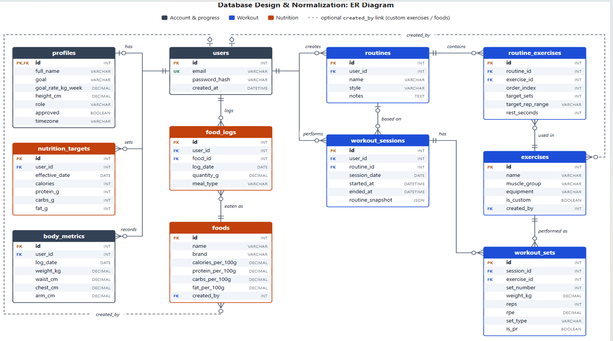
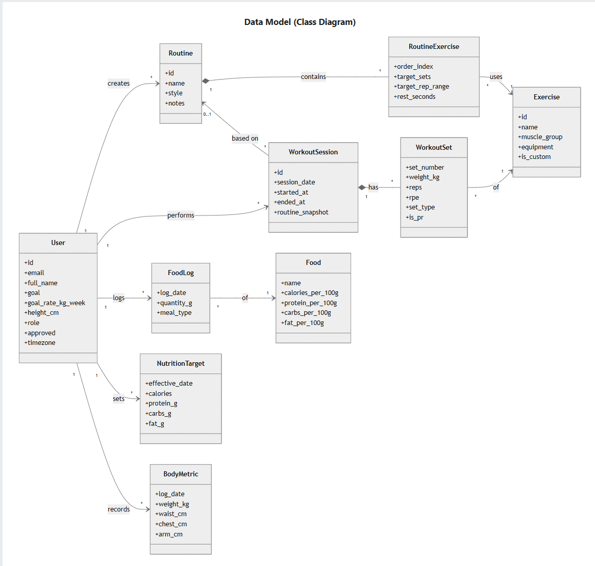
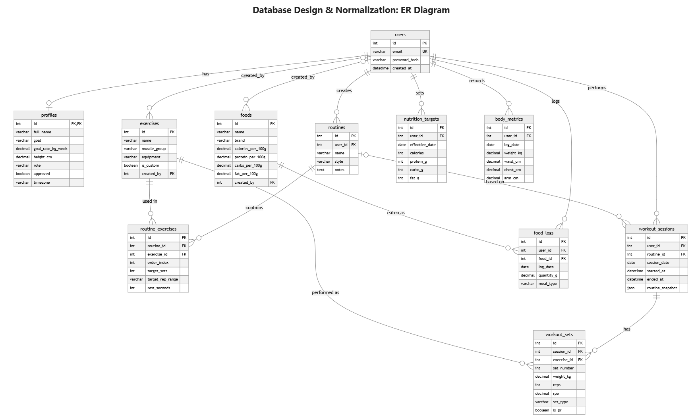

# WeighsFit Local (DBMS course project)

The full FitStack app (`frontend/`) running on your own PC with a **MySQL** database instead of Supabase.
weighsfit.in and Supabase are not touched.

```
browser (localhost:5173)  ->  api/server.js (localhost:4000)  ->  MySQL database `fitstack`  <-  MySQL Workbench
```

- `frontend/` - the real React app. Only `src/lib/supabase.ts` was replaced: it sends the same calls to the local API.
- `api/server.js` - small Express server: login, the data queries, and the same access rules as Supabase's row-level security.
- `schema.sql` - creates the `fitstack` database with 11 simple tables and sample data (no calorie-estimate tables) (load it in Workbench).
- `server.js` + `public/` - an extra small admin page on http://localhost:3000 (optional).

## Screenshots

### ER diagram (11 tables)


### Data model (class diagram)


### ER diagram - first draft


## User approval

Signup creates the `users` row and a `profiles` row (`approved`, `role`) in one transaction. With `AUTO_APPROVE=true` (default in `.env.example`) new accounts are approved straight away. Set it to `false` and new members land on a "pending approval" screen until an admin approves them on the Admin page. Unapproved members cannot read or write routines, workouts or food logs (enforced in `api/server.js`).

## First-time setup

1. Start MySQL: `services.msc` -> **MySQL80** -> Start.
2. Workbench: open `schema.sql`, click the lightning bolt. (Re-running it resets the database.)
3. Copy `.env.example` to `.env` (in this folder) and put your MySQL root password in `DB_PASSWORD`.
4. In this folder run `npm install`, then `cd frontend` and `npm install`.

## Run it (two terminals)

```
npm run api          # terminal 1 - local API on http://localhost:4000
npm run app          # terminal 2 - the website on http://localhost:5173
```

Open http://localhost:5173. Or double-click `run_all.bat`: it starts MySQL (asks for admin once and sets it to start automatically), the API and the website, then opens the browser. Works after a reboot. `run_frontend.bat` starts only the website.

## Logging in

- Sample users from the Supabase copy get the password **name-before-@ + 123** (for example `user2123`) when the API starts. The terminal prints the admin email
  (`user3@example.com`). Another sample user with data: `user2@example.com`.
- After the password, the app asks for a 6-digit code. Locally no email is sent: the code is **123456** for everyone.
- You can also register a new account on the site. New accounts are auto-approved (`AUTO_APPROVE=true` in `.env`).

## Show your mam

- Register or change data on the site, then refresh Workbench: `SELECT * FROM users;`, `SELECT * FROM body_metrics ORDER BY log_date DESC;`
- Add or delete a user in Workbench (see `docs/DEMO_QUERIES.md` style SQL), then log in with it on the site (new users need a `password_hash`, easiest is to register on the site instead).
- Delete a user: their profile and data go too (ON DELETE CASCADE).
- Draw the ER diagram: Workbench -> Database -> Reverse Engineer -> `fitstack`.

## Notes

- The edge function that emailed login notices is a no-op locally.
- If the website shows "Could not reach the local API", the API terminal is not running.
